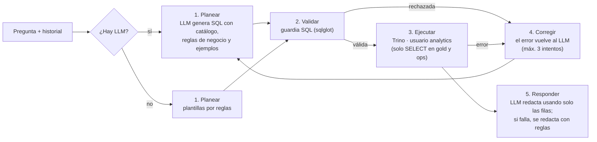

# Agente de IA del Data Lake («Preguntar al Data Lake»)

Permite a los administradores hacer preguntas en español sobre la capa Gold, por ejemplo *«¿qué sede tarda más en
resolver los tickets de redes en 2025?»* o *«los 5 técnicos con más tickets resueltos»*. El agente responde con:

- la respuesta en texto;
- la tabla de resultados, con descarga en CSV;
- una gráfica cuando aplica;
- la consulta SQL exacta que ejecutó.

- **Pantalla:** menú **Preguntar al Data Lake** (`/analitica/preguntar`, solo ADMIN).
- **API:** `POST /api/v1/agent/lago/preguntar` y `GET /api/v1/agent/lago/estado`, en `ai-service`.
- **Código:** `ai-service/app/lake/` y `frontend/src/app/pages/lake-agent.ts`.
- **Pruebas:** `ai-service/tests/test_lago.py` (40 pruebas).

## Cómo funciona (el «harness»)



| Paso | Qué hace | Dónde |
| --- | --- | --- |
| Catálogo | Tablas y columnas de `gold` y `ops`, leídas de `information_schema` (con respaldo estático), con descripción y reglas de negocio de `docs/datos/reglas-de-contabilizacion.md` | `catalogo.py` |
| Planear (IA) | El LLM devuelve JSON: `sql`, `explicacion`, `grafico`, o `aclaracion` si la pregunta no se puede responder con los datos | `agente.py` |
| Planear (sin IA) | Reconoce la métrica, la dimensión y los filtros de la pregunta, y arma el SQL desde plantillas | `plantillas.py` |
| Validar | Una sola consulta `SELECT` o `WITH`. Solo tablas existentes de `gold` y `ops`. Se rechazan DML, DDL, otros catálogos, `information_schema` y las capas Bronze y Silver. Se impone `LIMIT` | `guardia.py` |
| Ejecutar | Protocolo REST de Trino. Usuario `analytics` (`infrastructure/trino/rules.json`), tiempo máximo de 30 s y máximo 500 filas | `trino.py` |
| Corregir | Si la guardia o Trino rechazan la consulta, el motivo se le devuelve al modelo para que la corrija | `agente.py` |
| Responder | El modelo redacta usando **solo** las filas obtenidas; si falla, se redacta con reglas. La pantalla siempre muestra los datos y el SQL | `agente.py` |
| Auditoría | Cada pregunta queda en el registro de `ai-service`: usuario, modo, filas, intentos, duración y SQL | `docker compose logs ai-service` |

**Dos barreras de seguridad independientes.** La primera es la guardia SQL. La segunda es el usuario de Trino:
aunque un modelo intentara `DELETE` o leer otra capa, Trino lo rechaza porque `analytics` solo tiene `SELECT` sobre
`gold` y `ops`. Las capas Gold y ops no guardan nombres de usuarios ni correos (son seudónimos), así que el modelo no
ve datos personales de quienes reportan.

## Configuración (`.env`)

| Variable | Valor | Efecto |
| --- | --- | --- |
| `LLM_PROVIDER` | `heuristic` (por defecto) | Sin modelo de lenguaje: **modo plantillas** |
| | `openai` | Usa la API compatible con OpenAI (`LLM_BASE_URL`, `LLM_API_KEY`, `LLM_MODEL`) |
| | `ollama` | Usa Ollama local (`docker compose --profile ollama up -d`, y luego descarga el modelo) |
| `LAKE_AGENT_MODE` | `auto` / `plantillas` | `plantillas` fuerza las reglas aunque haya LLM |
| `LAKE_LLM_MODEL` | vacío | Modelo distinto para generar SQL (vacío = `LLM_MODEL`) |
| `LAKE_QUERY_TIMEOUT`, `LAKE_MAX_ROWS`, `LAKE_MAX_ATTEMPTS` | 30 / 500 / 3 | Límites de la consulta y de los intentos |

Ejemplo con Ollama, en Git Bash:

```bash
# en .env:  LLM_PROVIDER=ollama   LLM_MODEL=qwen2.5:7b
docker compose --profile ollama up -d
docker compose exec ollama ollama pull qwen2.5:7b
docker compose up -d --force-recreate ai-service
```

Después de cambiar `.env`, recrea `ai-service`. El indicador de la esquina de la pantalla muestra el modo activo
(«IA · modelo» o «Modo plantillas»).

## Qué entiende el modo plantillas

| Tipo | Opciones |
| --- | --- |
| Métricas | cantidad de tickets, finalizados, abiertos, cancelados, reabiertos, tiempo de resolución (horas o días), tiempo hasta la asignación, tiempo hasta la atención, satisfacción, acierto de la IA, reincidencia |
| Agrupaciones | sede, categoría, técnico, mes, año, día de la semana, hora, prioridad, estado, tipo de falla, equipo, canal |
| Filtros | sede (Bogotá, Bello o Medellín/Antioquia, Girardot), año, mes, «este año», «este mes», «últimos N días», «hoy», categoría (impresora, red/internet, accesos, hardware, software, periféricos), prioridad, «sin demo» |
| Extras | «los 5…», «¿cuál… más?», y preguntas de seguimiento como «¿y en Bello?» |

Con un LLM se pueden hacer preguntas libres: comparaciones entre sedes, uniones de tablas, porcentajes, cálculos
sobre las ejecuciones del pipeline (`ops.pipeline_runs`), etc.

## Limitaciones

- Un LLM puede escribir una consulta válida que **no** responde lo que se preguntó. Por eso la pantalla siempre
  muestra el SQL y la tabla; antes de usar una cifra en un informe, se revisa la consulta.
- La calidad del SQL depende del modelo: los modelos locales pequeños (≤ 7B) se equivocan más y necesitan más
  correcciones.
- La validación automática se hizo contra DuckDB, traduciendo el SQL de Trino con sqlglot, sobre tablas Gold
  sintéticas, no contra Trino. Las funciones de las plantillas (`count_if`, `day_of_week`, `date_trunc`, `year`) son
  de Trino.
