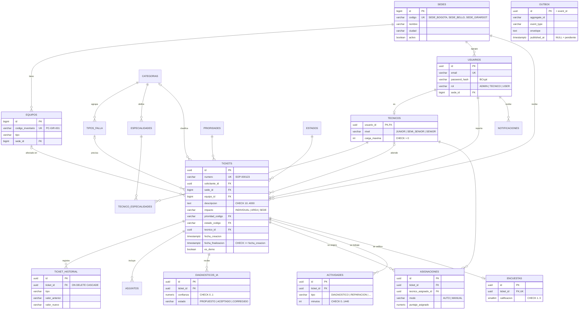

# 2. Hito 1 · Modelo relacional y operación de integridad

El componente transaccional es **PostgreSQL 17**. El esquema completo está en
`helpdesk-api/src/main/resources/db/migration/V1__esquema_inicial.sql` (Flyway lo aplica al arrancar) y los catálogos
y las tres sedes en `V2__datos_referencia.sql`. El diccionario de datos está en `docs/datos/diccionario-de-datos.md`.

## 2.1 Diagrama entidad-relación

GitHub dibuja este diagrama automáticamente (versión en imagen: [img/modelo-entidad-relacion.png](img/modelo-entidad-relacion.png)). Se muestran las claves y las columnas que explican las relaciones.



`OUTBOX` no tiene clave foránea a `TICKETS` a propósito: guarda eventos de varios agregados (tickets, técnicos,
usuarios) y debe conservarse aunque un registro de negocio se archive.

## 2.2 Decisiones del modelo

| Decisión | Justificación |
| --- | --- |
| 3FN en las tablas de negocio; catálogos (`estados`, `prioridades`, `categorias`, `tipos_falla`) como tablas con FK | Un estado o una prioridad inválidos se rechazan en la base, no solo en la aplicación |
| `CHECK` en dominios cerrados (`rol`, `impacto`, `canal`, `nivel`, calificación 1–5, minutos 0–1440) | La base es la última línea de defensa si un cliente salta las validaciones de la API |
| `ck_fechas`: la fecha de cierre no puede ser anterior a la de creación | Protege los indicadores de tiempo de resolución |
| `ON DELETE CASCADE` solo en los hijos que no tienen sentido sin su ticket (historial, adjuntos, actividades, encuestas) | Borrar una sede, un usuario o un técnico con tickets **se rechaza** |
| `cargo_solicitante` y `correo_solicitante` copiados en el ticket | Desnormalización deliberada: el ticket conserva cómo era la persona al reportar, aunque luego cambie de cargo |
| Tabla `outbox` escrita en la **misma transacción** que el cambio de negocio | El ticket y su evento se guardan juntos o no se guarda nada; nunca hay un ticket sin evento para el lago |
| `version` en `tickets` y `usuarios` | Bloqueo optimista: dos técnicos no pueden sobrescribirse un cambio |
| Índices por solicitante, técnico, estado, fecha y uno parcial para `requiere_revision` | Las consultas operativas filtran por esas columnas |

## 2.3 Operación de integridad demostrada

El script `pruebas/hito1-integridad.sql` se ejecuta contra la base real dentro de una transacción que termina en
`ROLLBACK` (no deja datos):

```bash
docker compose exec -T postgres psql -U postgres -d helpdesk -v ON_ERROR_STOP=1 < pruebas/hito1-integridad.sql
```

| # | Prueba | Resultado esperado |
| --- | --- | --- |
| 1 | Registrar ticket + historial + evento de outbox | Se guardan los tres |
| 2 | **Falla el evento a mitad de la operación** | El ticket también se revierte (atomicidad) |
| 3 | Número de ticket duplicado | Rechazado por `UNIQUE` |
| 4 | Ticket en una sede que no existe | Rechazado por FK |
| 5 | Estado fuera del catálogo | Rechazado por FK |
| 6 | Fecha de cierre anterior a la creación | Rechazado por `CHECK ck_fechas` |
| 7 | Encuesta con calificación 7 | Rechazado por `CHECK` |
| 8 | Borrar una sede que tiene tickets | Rechazado por FK |
| 9 | Borrar el ticket de prueba | Su historial se borra en cascada, sin huérfanos |

Además revisa los datos cargados (tickets sin solicitante, con sede inexistente, cerrados sin fecha o sin evento
de creación: todos deben dar 0) y muestra el reparto de tickets por sede.

**Resultado verificado** (PostgreSQL 17 con las migraciones V1 y V2): las 9 pruebas dieron **OK** y las 4 revisiones
de integridad referencial dieron **0**.
