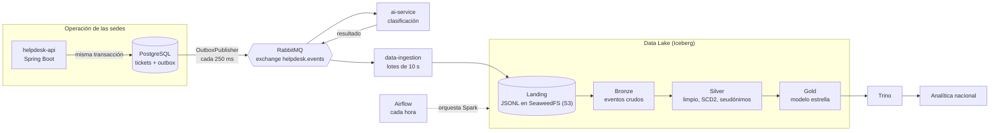
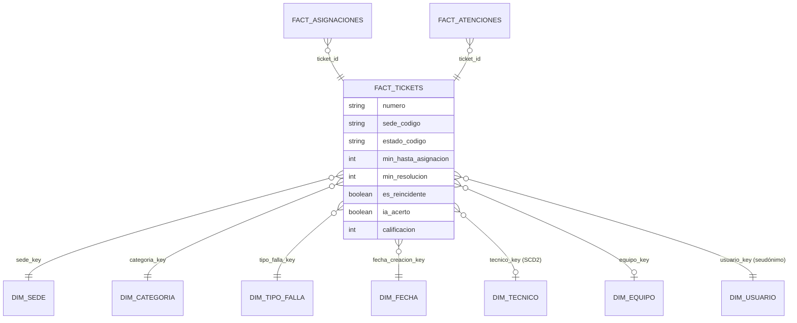

# 3. Hito 2 · Componente distribuido y prueba de sus consecuencias

## 3.1 El componente distribuido

La operación de las sedes (PostgreSQL) y la analítica nacional (el Data Lake) están en **procesos y almacenes
distintos**, unidos por mensajes:



| Pieza | Tecnología | Papel distribuido |
| --- | --- | --- |
| Outbox | Tabla en PostgreSQL | Hace atómico «cambiar el ticket + emitir el evento» sin transacciones distribuidas (2PC) |
| Broker | RabbitMQ | Desacopla productores y consumidores; entrega **al menos una vez** |
| Ingesta | `data-ingestion` (Python, aio-pika) | Agrupa eventos y los escribe como archivos en el almacenamiento de objetos |
| Almacén de objetos | SeaweedFS con API S3 | Guarda Landing y los archivos Parquet de Iceberg |
| Tablas del lago | Apache Iceberg 1.11, catálogo JDBC | Transacciones ACID y esquemas sobre archivos |
| Procesamiento | Spark 4.1 orquestado por Airflow 3 | Bronze → Silver → Gold por lotes |
| Consulta | Trino | SQL distribuido sobre Gold |

**Modelo de consistencia:** fuerte dentro de PostgreSQL; **eventual** entre PostgreSQL y el lago. La idempotencia
por `event_id` (anti-join en Bronze) convierte la entrega «al menos una vez» en «exactamente una vez» en el lago.

### Modelo estrella de la capa Gold



## 3.2 La prueba: caída del broker de mensajes

**Pregunta.** ¿Qué le pasa al sistema nacional si RabbitMQ, la pieza que une las sedes con la IA y el lago, se cae
unos minutos?

**Predicción (antes de ejecutar):**

1. Las tres sedes siguen registrando tickets: PostgreSQL no depende del broker (criterio C4).
2. Los eventos se acumulan en `outbox` con `published_at` vacío; no se pierde ninguno (C5).
3. **Consecuencia visible:** la clasificación por IA y la analítica nacional se **atrasan**. Durante la caída los
   tickets nuevos quedan sin categoría y sin técnico recomendado, y Gold muestra menos tickets que PostgreSQL.
4. Al volver el broker, el outbox se vacía en menos de 60 s (C6), la IA clasifica lo pendiente y, tras el pipeline,
   Gold vuelve a coincidir con PostgreSQL en cada sede, sin eventos duplicados (C5, C7).

**Ejecución** (Git Bash, con todo el sistema corriendo):

```bash
./pruebas/hito2-prueba-distribuida.sh          # 12 tickets (4 por sede) y 60 s de caída
./pruebas/hito2-prueba-distribuida.sh 30 300   # variante: 30 tickets y 5 minutos de caída
```

El script detiene RabbitMQ, crea los tickets por la API repartidos entre Bogotá, Bello y Girardot, mide lo que pasa,
restablece el broker, lanza el pipeline y compara PostgreSQL con Gold. Escribe la tabla de predicción contra
observación en `pruebas/resultados/hito2-AAAAMMDD-HHMM.md`.

## 3.3 Qué revela

- **Disponibilidad sobre consistencia (CAP en la práctica).** El diseño elige que las sedes sigan atendiendo; el
  precio es que la vista nacional queda desactualizada mientras dure la caída más el intervalo del pipeline.
- **La IA es un servicio asíncrono.** Si el broker cae, el sistema no se bloquea, pero los tickets esperan
  clasificación; por eso existe la bandera `requiere_revision` y la asignación manual del administrador.
- **El retraso normal del lago no es cero.** Aun sin fallas, un ticket aparece en la analítica en la siguiente
  ejecución de `lakehouse_pipeline` (cada hora, o al pulsar «Ejecutar ahora»). Antes de la prueba, el script registra
  ese desfase entre PostgreSQL y Gold.
- **Reparto desigual entre sedes.** Bogotá concentra ≈ 55 % de los tickets; una sede grande genera más eventos y
  pesa más en cada ejecución. Con más sedes conviene particionar por sede además de por fecha (ver informe, defensa).

## 3.4 Otras pruebas del componente distribuido ya realizadas

| Prueba | Resultado observado (17-nov-2026, carga de 34.709 tickets) |
| --- | --- |
| Volumen procesado | ≈ 373.000 eventos en Bronze; 287.948 filas escritas en Gold |
| Duración del pipeline completo | ≈ 2 minutos |
| Rechazos de calidad | 0 filas en cuarentena |
| Consistencia PostgreSQL = Gold | 34.709 = 34.709 |
| Duplicados en Bronze | 0 `event_id` repetidos |
| Primer intento sin carga incremental | Falló por memoria: Bronze releía 3 días de Landing; se corrigió con carga incremental en bloques de 25.000 |

Estas cifras corresponden a la carga anterior (con 4.709 tickets repetidos de una segunda ejecución). Después de
reiniciar y regenerar los 30.000 tickets, se vuelven a medir con las consultas de `docs/datos/carga-masiva.md`.
