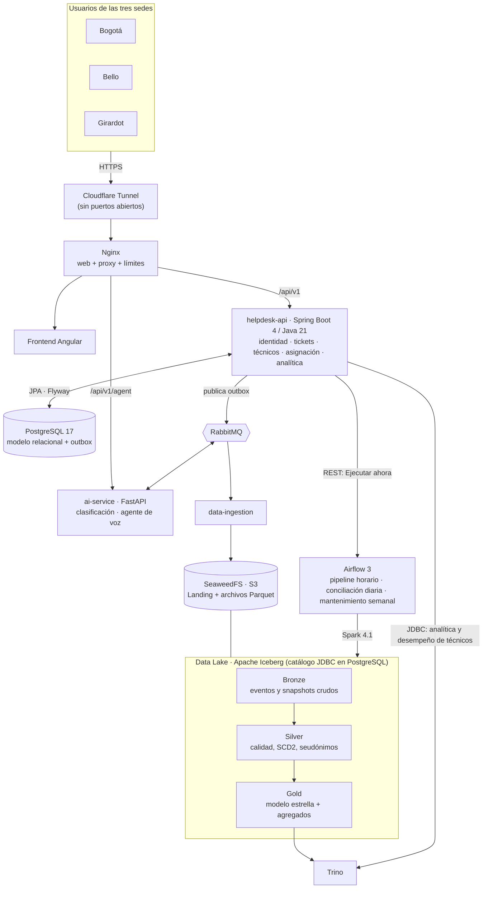

# Informe técnico · Solución de base de datos para el soporte de TI de UNIMINUTO

**Proyecto final · Diseño de una solución de base de datos para el desafío nacional UNIMINUTO**
Sedes modeladas: Bogotá (Sede Principal Minuto de Dios, Engativá), Bello (Rectoría Antioquia - Chocó) y Girardot
(Centro Regional).

## 1. Resumen

Se diseñó y construyó una mesa de ayuda de TI para tres sedes reales de UNIMINUTO. La operación diaria se registra en
una base relacional (PostgreSQL) con restricciones que impiden datos inválidos y una tabla outbox que hace atómico
el registro de cada cambio y su evento. Los eventos viajan por un broker (RabbitMQ) hacia un servicio de IA que
clasifica los casos y hacia un Data Lake (Apache Iceberg con capas Bronze, Silver y Gold, procesado con Spark y
consultado con Trino) que da a la coordinación nacional una vista comparable de todas las sedes. Se probó con
30.000 tickets simulados entre enero de 2024 y noviembre de 2026.

## 2. Problema y criterios

El problema, los afectados, los hechos documentados frente a los supuestos, el alcance nacional y los 11 criterios de
éxito fijados **antes** de las pruebas están en [01-problema-y-criterios.md](01-problema-y-criterios.md).

## 3. Arquitectura



Versión en imagen: [img/arquitectura.png](img/arquitectura.png). Los diagramas de detalle están en cada hito: el modelo entidad-relación en
[02-hito1-modelo-relacional.md](02-hito1-modelo-relacional.md) y el flujo distribuido y el modelo estrella en
[03-hito2-distribuido.md](03-hito2-distribuido.md).

## 4. Decisiones de diseño

| # | Decisión | Alternativa descartada | Por qué |
| --- | --- | --- | --- |
| D1 | PostgreSQL relacional en 3FN para la operación | Documental (MongoDB) | Los tickets tienen relaciones fuertes (sede, equipo, técnico, estado) y reglas que la base debe hacer cumplir |
| D2 | Restricciones en la base (FK, `CHECK`, `UNIQUE`), no solo en la API | Validar solo en Java | Ningún cliente, script o carga masiva puede saltarse las reglas (hito 1) |
| D3 | Patrón outbox en la misma transacción | Publicar al broker desde el código después del `COMMIT` | Evita tickets sin evento o eventos sin ticket; no requiere transacciones distribuidas |
| D4 | Entrega «al menos una vez» + idempotencia por `event_id` | «Exactamente una vez» en el broker | Más simple y robusto; los duplicados se descartan en Bronze con un anti-join |
| D5 | Separar OLTP (PostgreSQL) y OLAP (lago) | Analítica directa sobre PostgreSQL | Las consultas de años de historia no compiten con el registro de tickets |
| D6 | Iceberg sobre almacenamiento de objetos | Tablas Hive / Parquet suelto | Transacciones ACID, evolución de esquema, viaje en el tiempo y borrado selectivo (purga) |
| D7 | Medallion: Bronze inmutable, Silver validado, Gold de negocio | Una sola capa | Se puede reprocesar desde Bronze; la calidad se mide y los rechazos van a cuarentena |
| D8 | Seudónimos SHA-256 con sal en Silver | Copiar correos y nombres al lago | La analítica nacional no necesita datos personales (Ley 1581 de 2012) |
| D9 | SCD2 para técnicos | Sobrescribir el nivel | El desempeño histórico se atribuye al nivel que tenía el técnico en ese momento |
| D10 | Silver y Gold se reconstruyen completos; Bronze es incremental | Todo incremental | A esta escala tarda ≈ 2 min y es idempotente; es la primera decisión a revisar con más sedes |
| D11 | Sede como dato (`sedes`), no como código | Una base por sede | Agregar una sede es una fila; todas comparten definiciones |
| D12 | Agente de IA que traduce preguntas en español a SQL sobre Gold, con guardia SQL, usuario de Trino de solo lectura y ciclo de corrección | Dar acceso directo a Trino o un chatbot sin control | La coordinación pregunta sin saber SQL, y cada respuesta muestra la consulta y los datos que la sustentan ([detalle](../arquitectura/agente-data-lake.md)) |

El historial de decisiones de implementación está en `docs/arquitectura/decisiones.md`.

## 5. Resultados: predicción contra observación

Las predicciones se escribieron antes de ejecutar cada prueba. «Observado» viene de los archivos que generan los
scripts de `pruebas/` (se guardan en `pruebas/resultados/`) o de `ops.pipeline_runs`.

| Criterio | Predicción | Observado | ¿Cumple? | Evidencia |
| --- | --- | --- | --- | --- |
| C1 · Datos inválidos rechazados | 7 de 7 | 7 de 7 | ✅ | `hito1-integridad.sql`, pruebas 2 a 8 |
| C2 · Registro atómico | 0 tickets si falla el evento | 0 | ✅ | `hito1-integridad.sql`, prueba 2 |
| C3 · Huérfanos en los datos | 0 | 0 en la base de prueba · *[repetir con los 30.000]* | ✅ | `hito1-integridad.sql`, revisión final |
| C4 · Registro con el broker caído | 100 %, < 2 s | *[copiar de hito2-….md]* | | `hito2-prueba-distribuida.sh` |
| C5 · Sin pérdidas ni duplicados | Bronze = outbox, 0 repetidos | Carga anterior: 0 repetidos · *[copiar de hito2-….md]* | | `hito2-prueba-distribuida.sh` |
| C6 · Recuperación del outbox | < 60 s | *[copiar de hito2-….md]* | | `hito2-prueba-distribuida.sh` |
| C7 · PostgreSQL = Gold por sede | Iguales | Carga anterior: 34.709 = 34.709 · *[copiar de hito2-….md]* | | `hito2-prueba-distribuida.sh` |
| C8 · Rechazos de calidad | < 5 % | 0 % (0 filas en cuarentena) | ✅ | `ops.dq_results` (carga del 17-nov-2026) |
| C9 · Punta a punta | < 15 min | *[copiar de hito3-….md]* | | `hito3-flujo-integrado.sh` |
| C10 · Tiempos de la API | Registro < 2 s; analítica < 3 s | *[copiar de hito3-….md]* | | `hito3-flujo-integrado.sh` |
| C11 · Pipeline con la carga completa | < 10 min | ≈ 2 min (34.709 tickets, ≈ 373.000 eventos) | ✅ | `ops.pipeline_runs` (carga del 17-nov-2026) |

**Diferencias entre lo predicho y lo observado durante el desarrollo**, y qué se aprendió:

| Se predijo | Se observó | Causa | Corrección |
| --- | --- | --- | --- |
| Bronze procesaría 360.000 eventos sin problema | El primer intento se quedó sin memoria y Docker dejó de responder | Bronze releía 3 días de Landing en cada ejecución y los juntaba en memoria | Carga incremental (omite archivos ya cargados) en bloques de 25.000 eventos |
| Los tableros mostrarían los datos de Gold | Mostraban 0 aunque Gold tenía datos | El controlador JDBC de Trino enviaba mal los parámetros de fecha | Fecha como texto ISO y `CAST(? AS date)` en SQL |
| Una ejecución del generador daría 30.000 tickets | Quedaron 34.709 | Se lanzó una segunda ejecución parcial | Se documentó la purga (`scripts/purgar-tickets.sh`) y se regeneró la base desde cero |

## 6. Limitaciones

- Los 30.000 tickets son **simulados**; la reincidencia sale alta (≈ 56 % con la regla de 30 días) porque los datos
  sintéticos son densos para pocos equipos. No describe a UNIMINUTO.
- La precisión de la IA en los datos de demostración es simulada; la clasificación real depende del modelo
  configurado.
- Todo corre en un solo equipo con Docker Compose: los componentes son distribuidos por procesos, no por máquinas.
- PostgreSQL es central: una sede lejana depende de la red hasta ese servidor.

## 7. Preparación de la defensa

**¿Dónde está la evidencia de que la base protege la integridad?**
En `pruebas/hito1-integridad.sql`: 6 intentos de datos inválidos rechazados por la propia base (no por Java) y una
falla a mitad de la operación que revierte el ticket. Se corre en vivo en menos de un segundo y no deja datos.

**¿Qué pasa si se cae una pieza?**
Si cae RabbitMQ, las sedes siguen registrando y los eventos esperan en el outbox (hito 2). Si cae el lago o Airflow,
la operación no se entera; la analítica se atrasa y la conciliación diaria (`lakehouse_reconcile`) detecta
diferencias. Si cae PostgreSQL, sí se detiene la operación: es el punto único de falla (ver la siguiente pregunta).

**¿Cómo saben que no se pierden ni se duplican eventos?**
Cada evento tiene un `event_id` único que nace en el outbox. Bronze descarta los que ya tiene (anti-join), y la
prueba compara los eventos de cada ticket en el outbox con los de Bronze y cuenta los `event_id` repetidos.

**¿Por qué no consultar la analítica directamente en PostgreSQL?**
Porque un tablero de tres años recorre cientos de miles de filas y competiría con el registro de tickets de las
sedes. Además el lago conserva la historia completa (Bronze), permite reprocesar y separa los datos personales.

**Si UNIMINUTO pasara de 3 a 30 sedes, ¿qué decisión reconsiderarían primero?**
1. **D10 · Reconstruir Silver y Gold completos en cada ejecución.** Crece con toda la historia; con 30 sedes se
   cambiaría a `MERGE INTO` incremental por partición de fecha (Iceberg lo soporta) y se particionaría también por
   sede.
2. **PostgreSQL único y central.** Para sedes lejanas o muy grandes: réplicas de lectura, particionar `tickets` por
   sede o por fecha, o una base por regional con el mismo esquema alimentando el mismo lago (el outbox ya lo permite,
   porque el lago no depende de dónde nace el evento).
3. **Lotes horarios.** Si la coordinación necesita ver incidentes masivos en minutos, se pasaría a procesamiento en
   flujo sobre los mismos eventos.
4. **RabbitMQ en un solo nodo.** Se pasaría a un clúster con colas *quorum*.

**¿Qué impide que el agente de IA borre o invente datos?**
Tiene dos barreras independientes. La primera es una guardia SQL que solo acepta una consulta de lectura sobre las
tablas de `gold` y `ops`. La segunda es Trino, que ejecuta con el usuario `analytics`, que solo tiene permiso de
`SELECT` sobre esos esquemas. Para las cifras: el modelo redacta la respuesta usando únicamente las filas devueltas, y
la pantalla muestra siempre la tabla y el SQL. Lo comprueban las pruebas `test_llm_malicioso_nunca_llega_a_trino` y
`test_llm_corrige_su_consulta_con_el_error`.

**¿Qué datos son reales y cuáles supuestos?**
Reales: las sedes y su ubicación (uniminuto.edu). Supuestos: volumen, reparto entre sedes, usuarios y técnicos, y
el acierto de la IA. Todo dato generado lleva `es_demo = true` (ver 01, tabla de hechos y supuestos).

## 8. Cómo reproducir

1. `./scripts/iniciar.sh` (crea `.env` y levanta todo).
2. Administrador → **Configuración → Escenario de demostración → Carga masiva (30.000 tickets desde 2024)**.
3. Cuando el outbox esté vacío, **Pipeline del Data Lake → Ejecutar ahora**.
4. Pruebas, en orden:

```bash
docker compose exec -T postgres psql -U postgres -d helpdesk -v ON_ERROR_STOP=1 < pruebas/hito1-integridad.sql
./pruebas/hito2-prueba-distribuida.sh
./pruebas/hito3-flujo-integrado.sh
```

5. Copiar los valores observados de `pruebas/resultados/` en la tabla de la sección 5.

## Referencias

- Armbrust, M., Ghodsi, A., Xin, R. y Zaharia, M. (2021). Lakehouse: A new generation of open platforms that unify
  data warehousing and advanced analytics. *CIDR 2021*.
- Apache Software Foundation. (s. f.). *Apache Iceberg documentation*. https://iceberg.apache.org/docs/latest/
- Kleppmann, M. (2017). *Designing data-intensive applications*. O'Reilly Media.
- Richardson, C. (2018). *Microservices patterns*. Manning. (Patrón outbox transaccional.)
- Congreso de Colombia. (2012). Ley Estatutaria 1581 de 2012, por la cual se dictan disposiciones generales para la
  protección de datos personales.
- Corporación Universitaria Minuto de Dios – UNIMINUTO. (s. f.). *Encuentra tu sede*. https://www.uniminuto.edu/
